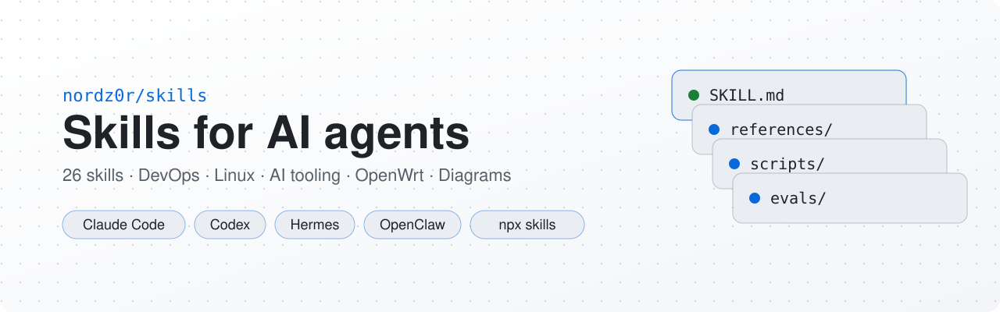
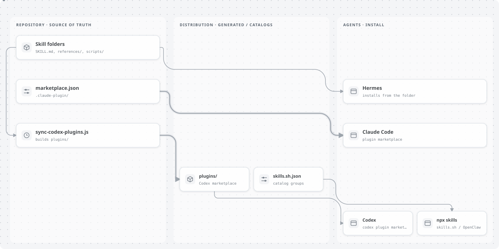
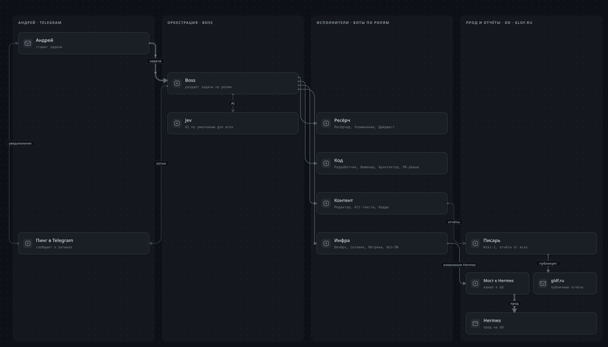

<p align="center">
  <picture>
    <source media="(prefers-color-scheme: dark)" srcset=".github/assets/banner-dark.svg">
    <source media="(prefers-color-scheme: light)" srcset=".github/assets/banner-light.svg">
    
  </picture>
</p>

<p align="center"><a href="README.md">Русский</a> · <b>English</b></p>

<p align="center">
  <a href="#catalog"></a>
  
  
  
  
  <a href="https://skills.sh/nordz0r/skills"></a>
  <a href="https://github.com/nordz0r/skills/stargazers"></a>
</p>

28 skills for `Claude Code`, `Codex`, `Hermes` and other agents that read `SKILL.md`: DevOps and SRE, Linux and Docker, LiteLLM and Open WebUI, Nextcloud and Atlassian, OpenWrt, Telegram and animated diagrams. Each skill is a folder with `SKILL.md` plus optional `references/`, `scripts/` and `evals/`. `SKILL.md` files are in English; translated skills keep the Russian original in `references/README.ru.md`.

## ⚡ Quick start

```bash
npx skills add nordz0r/skills
```

Other agents, one command each:

| Agent | Command |
|---|---|
| Claude Code | `claude plugin marketplace add nordz0r/skills && claude plugin install all-skills@nord-skills` |
| Codex | `codex plugin marketplace add nordz0r/skills && codex plugin add all-skills@nord-skills` |
| Hermes Agent | `hermes skills install nordz0r/skills/<skill>` |
| One skill via `npx` | `npx skills add nordz0r/skills -s pr-lens-diagrams -g` |

<details>
<summary><b>Detailed install: bundles, flags, Hermes tap, updates</b></summary>

This repository is structured for universal integration: install it directly as an official **Claude Code Plugin / Marketplace** or via **`npx skills`** for `Codex`, `OpenClaw`, and other AI agents.

#### 1. Claude Code (Plugin Marketplace)

```bash
# 1. Register marketplace in Claude Code
claude plugin marketplace add nordz0r/skills

# 2. Install bundle or individual plugins:
claude plugin install all-skills@nord-skills       # Complete 28 skills collection
claude plugin install agency-skills@nord-skills    # Agency engineering bundle
claude plugin install infra-linux@nord-skills      # Linux, Docker, CI/CD, Ansible
claude plugin install ai-tools@nord-skills         # LiteLLM, WebUI, OpenCodex
claude plugin install nextcloud@nord-skills        # Nextcloud: files + Collectives wiki
claude plugin install openwrt-routing@nord-skills  # OpenWrt (AmneziaWG, Podkop, zapret)
claude plugin install telegram-formatting@nord-skills  # Telegram Rich Markdown/HTML
claude plugin install pr-lens-diagrams@nord-skills     # PR Lens animated diagrams

# Inside an active Claude Code interactive session:
/plugin marketplace add nordz0r/skills
/plugin install all-skills@nord-skills
```

#### 2. OpenAI Codex (Plugins — same packages as ChatGPT)

Codex CLI reads this repository as a **plugin marketplace**: `.agents/plugins/marketplace.json` sits at the repo root, and each bundle is a standalone plugin with its own `.codex-plugin/plugin.json` manifest and skills under `skills/`. Plugins are browsable via `/plugins` in an interactive Codex session or in the ChatGPT desktop app.

```bash
# 1. Add the marketplace to Codex
codex plugin marketplace add nordz0r/skills

# 2. Install a bundle:
codex plugin add openwrt-routing@nord-skills
codex plugin add nextcloud@nord-skills

# 3. See what is installed:
codex plugin list
```

Inside an interactive Codex session: `/plugins` — pick the `nord-skills` marketplace and install any of the six bundles (`all-skills`, `agency-skills`, `infra-linux`, `ai-tools`, `nextcloud`, `openwrt-routing`).

Installed skills become available in new sessions and are invoked by name (`openwrt-routing:zapret-openwrt-guide`) or matched automatically from the task description.

> The plugin layout is generated by `scripts/sync-codex-plugins.js` from `.claude-plugin/marketplace.json`: do not hand-edit `plugins/`, change the source and re-sync instead.

#### 3. OpenClaw and Agent CLIs (`npx skills`)

```bash
# List available skills
npx skills add nordz0r/skills -l

# Install all skills into the current project
npx skills add nordz0r/skills

# Install all skills globally
npx skills add nordz0r/skills -g

# Install one skill
npx skills add nordz0r/skills -s litellm-guide -g
```

| Flag | Description |
|------|-------------|
| `-l`, `--list` | Lists available skills without installing |
| `-s`, `--skill <name>` | Installs only the specified skill |
| `-g`, `--global` | Installs skill globally |
| `-y`, `--yes` | Skips confirmation prompts |

Restart the agent session after installation when possible. Many CLIs only load the available skill list on startup.

#### 4. Hermes Agent (`hermes skills`)

The repository is compatible with Hermes Agent (Nous Research): skills install straight from GitHub and update through the built-in hub lifecycle.

```bash
# Install a single skill directly (owner/repo/<skill-dir>)
hermes skills install nordz0r/skills/open-webui-guide

# Add the whole repository as a tap (browsable via /skills browse)
hermes skills tap add nordz0r/skills
```

`tap add` defaults to scanning a `skills/` subdirectory, while this repository keeps skills at the root — so after adding the tap, set the path in `$HERMES_HOME/skills/.hub/taps.json` (`HERMES_HOME` defaults to `~/.hermes`):

```json
{
  "taps": [
    { "repo": "nordz0r/skills", "path": "" }
  ]
}
```

Skills Hub categories are read from `skills.sh.json` at the repository root. Note that `search`/`browse` walks the large built-in taps first (openai, anthropics, NVIDIA, etc.), so a freshly added tap may not surface in search immediately — direct install by identifier always works.

```bash
# Check which installed skills changed upstream
hermes skills check

# Update only skills with upstream changes (local edits are preserved)
hermes skills update

# Force-overwrite a single skill
hermes skills update open-webui-guide --force
```

On install Hermes copies `SKILL.md` plus only the files it references (`references/`, `scripts/`); private repos need `GITHUB_TOKEN`. Without a token the GitHub API is limited to 60 requests/hour.

</details>

## 🗺️ How it fits together

<p align="center">
  <picture>
    <source media="(prefers-color-scheme: dark)" srcset=".github/assets/architecture-dark.svg">
    <source media="(prefers-color-scheme: light)" srcset=".github/assets/architecture-light.svg">
    
  </picture>
</p>

The skill folders and `.claude-plugin/marketplace.json` are the source of truth. `scripts/sync-codex-plugins.js` derives `plugins/` for Codex, `skills.sh.json` groups skills for catalogs, and Hermes installs a skill straight from its folder. The diagram was drawn with [`pr-lens-diagrams`](pr-lens-diagrams/) (labels in Russian).

<a id="catalog"></a>
## 📦 Catalog

### 🛠️ Engineering & product work

| | Skill | What it does |
|---|---|---|
| 🚀 | [`agency-devops-automator`](agency-devops-automator/) | CI/CD, Terraform, Kubernetes, Helm, Vault, rollout and rollback |
| 📈 | [`agency-sre`](agency-sre/) | SLO/SLI, alerts, observability, capacity |
| 🚨 | [`agency-incident-response-commander`](agency-incident-response-commander/) | SEV triage, rollback, postmortem, comms |
| 🔐 | [`agency-security-engineer`](agency-security-engineer/) | Threat modeling, auth, secrets, hardening |
| 🗄️ | [`agency-database-optimizer`](agency-database-optimizer/) | PostgreSQL/MySQL: schema, indexes, EXPLAIN, migrations |
| ✍️ | [`agency-technical-writer`](agency-technical-writer/) | README, runbooks, migration guides, operator docs |
| 🎤 | [`preview-interview`](preview-interview/) | Interview prep and mock sessions |

### 🐧 Linux, Docker, CI/CD

| | Skill | What it does |
|---|---|---|
| 🖥️ | [`administering-linux`](administering-linux/) | systemd, journald, disks, SSH, packages |
| 🐳 | [`docker-ops`](docker-ops/) | Dockerfile, Compose v2, healthchecks, networks, volumes |
| 🦊 | [`gitlab-ci`](gitlab-ci/) | `.gitlab-ci.yml`, rules, runners, dind, Registry |
| 📜 | [`ansible-playbook`](ansible-playbook/) | Playbooks, roles, inventory, vault, `--check --diff` |
| 🛡️ | [`amnezia-vpn`](amnezia-vpn/) | AmneziaVPN/AWG on Linux and Docker |
| 🛰️ | [`xray-reality`](xray-reality/) | Xray VLESS + REALITY/XHTTP: server, clients, versions |
| 🔐 | [`vpn-setup`](vpn-setup/) | Self-hosted VPN playbook: AWG vs Xray, verify, troubleshoot |
| 🧭 | [`linux-routing`](linux-routing/) | Policy routing, fwmark, nftables NAT, split tunnel |

### 🤖 AI tooling & integrations

| | Skill | What it does |
|---|---|---|
| 🔀 | [`litellm-guide`](litellm-guide/) | LiteLLM: SDK, proxy, providers, routing, MCP |
| 🧩 | [`opencodex-guide`](opencodex-guide/) | OpenCodex: account pools, routing, CLI |
| 💬 | [`open-webui-guide`](open-webui-guide/) | Open WebUI: auth, pipelines, RAG, API, scaling |
| ⌨️ | [`open-terminal-guide`](open-terminal-guide/) | Open Terminal: terminal REST API for agents |
| ☁️ | [`nextcloud-admin`](nextcloud-admin/) | Nextcloud via OCS API and WebDAV |
| 📚 | [`nextcloud-collectives`](nextcloud-collectives/) | Nextcloud Collectives wiki: pages, search, tags |
| 🔎 | [`elk-kibana-dashboards`](elk-kibana-dashboards/) | Elasticsearch/Kibana: logs, dashboards, KQL |
| 🧷 | [`atlassian`](atlassian/) | Jira, Confluence, Bitbucket: Cloud and Data Center |

### ✈️ Telegram & diagrams

| | Skill | What it does |
|---|---|---|
| 📨 | [`telegram-formatting`](telegram-formatting/) | Telegram Rich Markdown/HTML, Bot API, builder and images |
| 🎞️ | [`pr-lens-diagrams`](pr-lens-diagrams/) | Animated diagrams via PR Lens → SVG, GIF, MP4 |

### 📡 OpenWrt & networking

| | Skill | What it does |
|---|---|---|
| 🔒 | [`amneziawg-openwrt-guide`](amneziawg-openwrt-guide/) | AmneziaWG on OpenWrt: UCI/LuCI, peers, watchdog |
| 🧦 | [`podkop-openwrt-guide`](podkop-openwrt-guide/) | Podkop + sing-box: selective routing, FakeIP |
| 🕳️ | [`zapret-openwrt-guide`](zapret-openwrt-guide/) | zapret: DPI desync, nfqws, hostlists |

## ✨ Showcase

### 🎞️ pr-lens-diagrams — animated diagrams

The agent writes a `graph.json`; the skill validates it, renders it with [PR Lens](https://github.com/coldteadotai/pr-lens) and records seamless GIF and MP4 loops. Below is the output for [`examples/bots.graph.json`](pr-lens-diagrams/examples/bots.graph.json); the diagram above was made the same way.

<p align="center"></p>

```bash
bash pr-lens-diagrams/scripts/pr-lens-build.sh graph.json out/   # → out/architecture.{svg,gif,mp4}
```

### 📨 telegram-formatting — Telegram Rich Markdown and HTML

Gateway tables and checklists, direct Bot API Rich HTML and the `tg-rich-messages` TypeScript builder: choose delivery paths, validate payloads, handle media and avoid publishing private images. Includes evals.

### 🔀 litellm-guide — LiteLLM from SDK to proxy

SDK, proxy/gateway, providers, routing, virtual keys, MCP/A2A, and developing inside the LiteLLM repo. Six reference files plus evals for the routing benchmark.

<details>
<summary><b>How to invoke skills and how auto-routing is tested</b></summary>

### Explicit invocation

Call the skill by name in your first prompt.

```text
Use agency-devops-automator and build CI/CD for k3s with rollback.
Use agency-technical-writer and rewrite a stale runbook.
Use telegram-formatting for a Telegram Rich Markdown reply.
```

#### Automatic triggering

Automatic triggering usually depends on `description` inside `SKILL.md`. To improve matching:

- use domain-specific wording
- include concrete product or technology names
- call the skill explicitly when the outcome must be deterministic

### Routing benchmark

The repository includes [`tools/a_evolve_router`](tools/a_evolve_router/), a small benchmark for checking whether `SKILL.md` wording routes user prompts to the right skill. It reads eval cases from top-level `<skill>/evals/evals.json`, adds ambiguous stress cases from `supplemental_cases.json`, and runs against an isolated workspace copy so real skill directories are not mutated during the experiment.

Use it to:

- check trigger-wording baseline after adding or editing a skill;
- stress-test nearby skills that may be confused by auto-routing;
- run a local `a-evolve` loop that improves routing signals in the workspace copy;
- compare `train`/`holdout` accuracy before copying phrasing back into real `SKILL.md` files.

Quick baseline without installing `a-evolve`:

```bash
python3 -m tools.a_evolve_router.evaluate_baseline --split all
```

The full local `a-evolve` workflow is documented in [`tools/a_evolve_router/README.md`](tools/a_evolve_router/README.md). Use `--reset-workspace` for clean reruns from the current skill catalog.

**Metrics — historical snapshot as of 2026-09-20** (26 skills / 48 cases; as of 2026-10-15 the catalog has 28 skills, not re-run yet):

| State | top1 acc | avg_score |
|-------|----------|-----------|
| Pilot 2026-09-01 | 0.8364 (46/55) | 0.8745 |
| Quoted `description` + `нужно` stopword | 1.0000 (64/64) | 1.0000 |
| After dropping `basic-memory` / `lightpanda` | 1.0000 (63/63) | 1.0000 |
| After dropping 4 design-agency skills | **1.0000 (48/48)** | 1.0000 |

The router still reads only the first `description:` line, so folded `>-` blocks look empty — keep a quoted one-liner. The heuristic engine remains net-negative. Skillforge (`--engine skillforge`) mutates only the isolated `.workdir/`.

</details>

## ⭐ Star History

<p align="center">
  <a href="https://www.star-history.com/#nordz0r/skills&Date">
    <picture>
      <source media="(prefers-color-scheme: dark)" srcset="https://api.star-history.com/svg?repos=nordz0r/skills&type=Date&theme=dark">
      
    </picture>
  </a>
</p>

## 🤝 Contributing

New skills and fixes go through pull requests.

1. A `kebab-case` folder with `SKILL.md`; frontmatter `name` matches the folder, `description` is a concrete quoted one-liner.
2. Register the skill in `.claude-plugin/marketplace.json`, `skills.sh.json` and both READMEs.
3. Regenerate plugins and validate:
   ```bash
   node scripts/sync-codex-plugins.js
   node scripts/validate-skills.js
   ```
4. Never hand-edit `plugins/`; it is generated.

Agent-facing details live in [`AGENTS.md`](AGENTS.md).

<details>
<summary><b>Repository structure</b></summary>

```text
skills/
├── .claude-plugin/
│   ├── marketplace.json  # Claude Code plugin marketplace catalog (bundles + individual skills)
│   └── plugin.json       # Root plugin manifest for direct installation
├── .agents/plugins/
│   └── marketplace.json  # OpenAI Codex / ChatGPT plugins marketplace catalog
├── plugins/              # Generated Codex plugins (do not edit by hand)
│   └── <bundle>/
│       ├── .codex-plugin/plugin.json
│       └── skills/<skill-name>/SKILL.md
├── scripts/
│   ├── validate-skills.js     # Validation tool for manifests, frontmatter, and paths
│   └── sync-codex-plugins.js  # Codex plugin generator driven by .claude-plugin/marketplace.json
├── README.md
├── README.en.md
├── AGENTS.md
├── tools/
│   └── a_evolve_router/  # experimental skill-routing benchmark
└── <skill-name>/
    ├── SKILL.md          # Primary instruction entrypoint + YAML frontmatter
    ├── agents/           # OpenAI/Codex agent manifest (openai.yaml)
    ├── evals/            # optional: benchmark prompts and routing evals
    ├── scripts/          # optional: bash scripts or automation helpers
    └── references/       # optional: in-depth domain documentation
```

</details>

---

<p align="center">
  <b>Found a skill useful? A ⭐ helps others find this repo.</b><br>
  <a href="https://github.com/nordz0r/skills/stargazers"></a>
</p>
